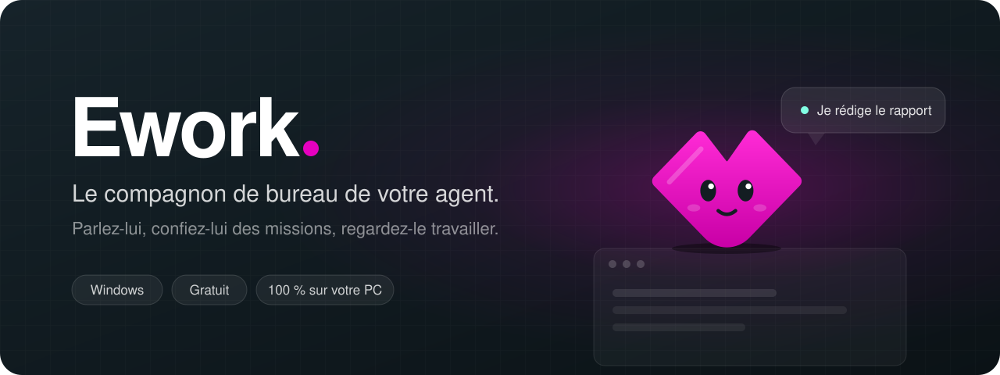

<p align="center">
  
</p>

<p align="center">
  <a href="https://github.com/maximelebatardsartre/ework/releases/latest"></a>
</p>

<p align="center">
  <a href="https://github.com/maximelebatardsartre/ework/releases/latest"></a>
  
  
  <a href="LICENCE-UTILISATION.md"></a>
</p>

---

**Ework** est un compagnon de bureau pour Windows. C'est le visage de votre agent d'intelligence artificielle : on lui parle, on lui confie des missions et on le voit travailler, sans terminal.

Ework est le cœur du logo EWE, dessiné et animé entièrement en code. Il marche sur le bord de vos fenêtres, saute de l'une à l'autre, suit l'heure de la journée, réagit à la souris, et se fait discret dès qu'une application passe en plein écran.

## Sommaire

- [Ce que fait Ework](#ce-que-fait-ework)
- [Installer Ework](#installer-ework)
- [Relier votre agent](#relier-votre-agent)
- [Mises à jour](#mises-à-jour)
- [Vérifier le fichier téléchargé](#vérifier-le-fichier-téléchargé)
- [Confidentialité](#confidentialité)
- [Licence](#licence)

## Ce que fait Ework

| | |
| --- | --- |
| **Il montre ce que fait l'agent** | Il écoute, réfléchit, rédige, cherche, lit, range, envoie, analyse, exécute, patiente… Plus de soixante-dix états animés, avec élan, respiration, clignements et un regard qui suit la souris. |
| **Une bulle au-dessus de lui** | Un clic sur Ework : vous écrivez une mission, la réponse s'y écrit, une ligne dit ce que fait l'agent. Vous approuvez ou refusez ce qu'il demande, vous l'arrêtez. Raccourci : `Alt + Maj + Espace`. |
| **Une fenêtre complète** | Six rubriques : Conversation, Missions, Fichiers, Progression, Apparence, Réglages. Les conversations sont gardées sur votre ordinateur. |
| **Il vous ressemble** | Couleur, yeux, bouche, couvre-chef, lunettes, col, lueur, nom : chacun fait le sien. |
| **Il vit avec vous** | Salut le matin, café, déjeuner, bâillements le soir, sommeil la nuit. Il réagit à une copie, à un fichier qu'on lui tend, à la musique, à votre retour. |
| **Il propose son aide** | Quand une aide paraît utile, une petite carte la propose. Rien ne part vers l'agent sans votre accord. Désactivable. |
| **Progression sobre** | Facultative et désactivée au départ : niveaux, rangs, badges, une carte à partager. Aucun classement entre personnes. |
| **Discret au travail** | Il se cache en plein écran, aux heures calmes, quand un programme choisi tourne, ou une heure sur demande. |

## Installer Ework

**Configuration** : Windows 10 ou 11, 64 bits. Un agent [Hermes](https://github.com/NousResearch/hermes-agent) avec son serveur d'API, sur votre ordinateur, votre réseau ou un serveur.

1. Ouvrez la [dernière version](https://github.com/maximelebatardsartre/ework/releases/latest).
2. Dans « Assets », téléchargez **`Ework_x.y.z_x64-setup.exe`**.
3. Lancez-le. L'installation se fait pour votre seul compte Windows, **sans droits administrateur**.
4. Ework apparaît sur le bord de votre écran.

> [!NOTE]
> **« Windows a protégé votre ordinateur »** : l'installeur n'a pas de certificat de signature de code payant. Cliquez sur **Informations complémentaires**, puis sur **Exécuter quand même**. Vous pouvez d'abord [vérifier le fichier](#vérifier-le-fichier-téléchargé).

Pour désinstaller : Paramètres de Windows › Applications › Ework › Désinstaller.

## Relier votre agent

1. Clic droit sur Ework, **Relier un agent**.
2. Collez ce que vous avez, puis **Connecter** :
   - l'adresse de l'agent, sous n'importe quelle forme (`192.168.1.20`, `agent.mondomaine.fr`, `https://…/v1`) ;
   - ou un bloc qui contient l'adresse et la clé (les lignes de son fichier `.env`, par exemple).
3. Ni adresse ni clé sous la main ? **Demander à mon agent** copie une consigne à coller dans la conversation de votre agent : il répond par un bloc à coller dans Ework.

La clé est rangée dans le gestionnaire d'identification de Windows et n'est jamais affichée. Ework accepte HTTPS partout, et HTTP seulement vers votre ordinateur ou votre réseau privé.

<details>
<summary><b>Préparer l'agent à la main</b></summary>

Sur la machine de l'agent, dans `~/.hermes/.env` :

```
API_SERVER_ENABLED=true
API_SERVER_KEY=une-longue-cle-secrete
```

Puis lancez `hermes gateway` : le serveur écoute sur le port 8642. Pour un serveur distant, passez par un tunnel SSH (`ssh -N -L 8642:127.0.0.1:8642 utilisateur@serveur`, puis l'adresse `http://127.0.0.1:8642`) ou par un proxy inverse en HTTPS.

</details>

## Mises à jour

Dans « Réglages », vous choisissez entre mises à jour **automatiques** ou **manuelles**. Ework vérifie au lancement, puis toutes les six heures, jamais en plein écran. Chaque mise à jour est **signée** : Ework vérifie la signature avant de l'installer et refuse toute mise à jour qui ne la porte pas.

## Vérifier le fichier téléchargé

Les installeurs sont compilés uniquement par GitHub Actions, jamais sur un ordinateur personnel. Pour vérifier que votre fichier est bien celui publié :

1. Téléchargez `SHA256SUMS.txt` dans la même version.
2. Dans PowerShell, dans le dossier du téléchargement :

   ```powershell
   Get-FileHash .\Ework_x.y.z_x64-setup.exe
   ```

3. L'empreinte affichée doit être identique à celle du fichier.

Ework n'est publié **que** sur cette page. Un installeur trouvé ailleurs n'est pas le nôtre.

## Confidentialité

Pas de compte, pas de télémétrie, pas de publicité. Ework ne contacte que l'agent que vous avez indiqué, et cette page pour les mises à jour. Ce qu'il observe sur votre ordinateur n'en sort pas. Tout le détail : [page de confidentialité](CONFIDENTIALITE.md).

## Licence

Ework est **gratuit**, pour un usage personnel comme professionnel. Il n'est **pas open source** : le code source n'est pas publié, et l'application ne peut être ni revendue, ni redistribuée, ni modifiée, ni décompilée. Son utilisation est régie par la [licence d'utilisation](LICENCE-UTILISATION.md).

Ework, son personnage et ses animations © 2026 eSpri Studio. Tous droits réservés. Le nom et le logo EWE appartiennent à EWE.

<p align="center">
  <sub>Développé par <b>eSpri Studio</b> · Un agent sur mesure pour votre entreprise ? <a href="https://ewe.works">ewe.works</a></sub>
</p>
